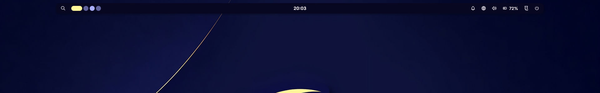
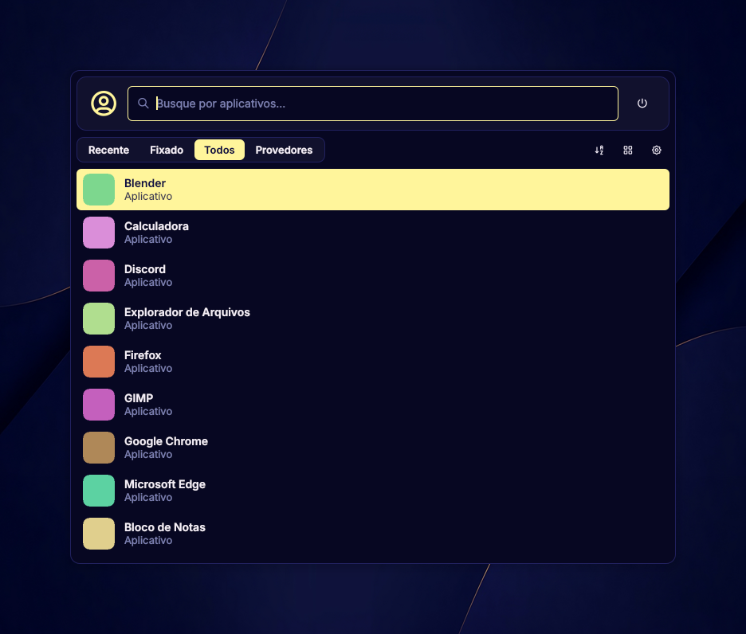
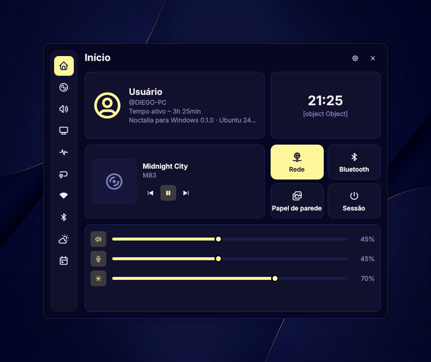
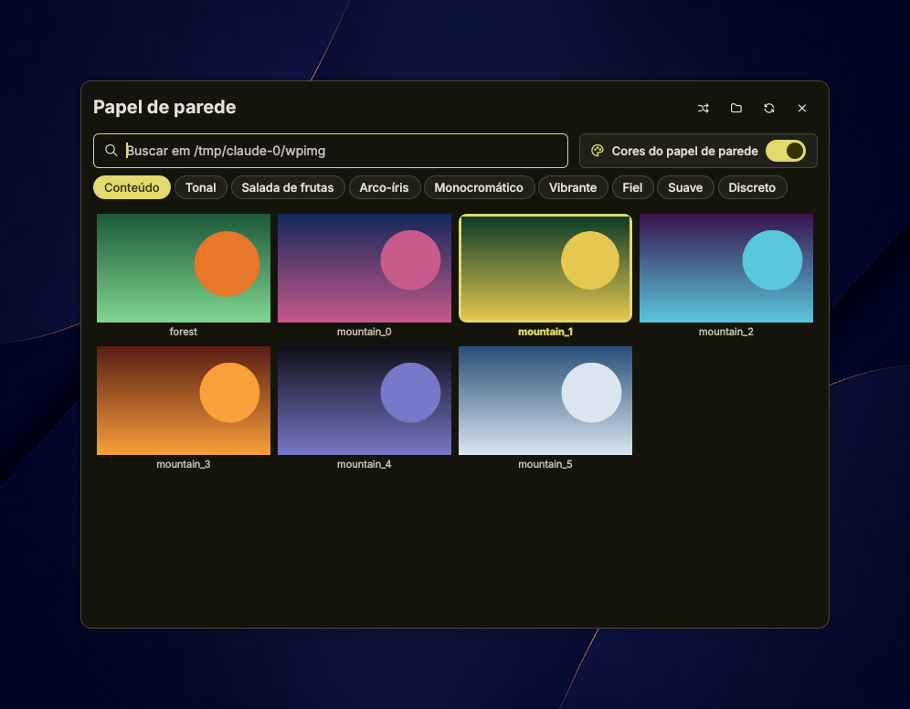
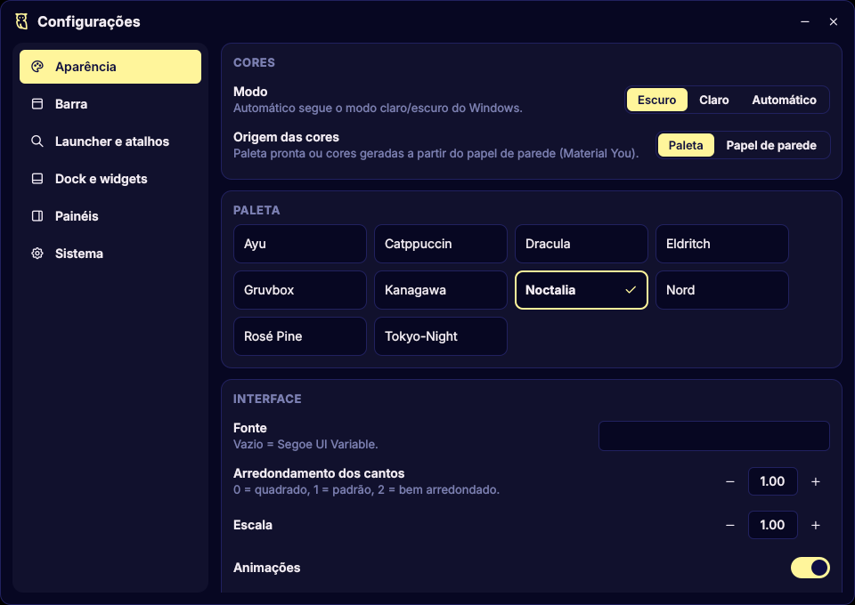

# Vitória Shell

Vitória Shell é uma personalização e port não oficial do [Noctalia](https://noctalia.dev) (desktop shell do Linux) para o Windows 10/11.
Mesma cara, mesmas paletas, mesmos ícones e o mesmo gerador de cores do Noctalia, reescrito em
**Qt 6 + C++ + QML** em cima das APIs do Windows.



| Launcher | Central de controle |
|---|---|
|  |  |
| **Papel de parede (cores geradas da imagem)** | **Configurações** |
|  |  |

## O que tem

As personalizações recentes estão descritas em [docs/personalizacoes.md](docs/personalizacoes.md):
widgets por arrastar e soltar, correção do desaparecimento da barra, relógio em português,
gato animado pela GPU, atualização das paletas e integração opcional com o NiriWin.

- **Barra** flutuante em cada monitor, que reserva espaço na tela como a barra de tarefas. Widgets:
  launcher, papel de parede, áreas de trabalho, relógio, mídia, bandeja, notificações, área de
  transferência, rede, Bluetooth, volume, brilho, bateria, clima, monitor do sistema, central de
  controle e sessão.
- **Launcher** (`Alt+Espaço`): todos os apps, inclusive os da Microsoft Store, com ícones e busca
  sem acento. Abas Recente / Fixado / Todos / Provedores, lista ou grade. Calculadora direto na
  busca, `/emo` emojis, `/win` janelas abertas, `/session` desligar etc.
- **Central de controle**: início, mídia (o "tocando agora" do Windows, com capa), áudio (saída,
  microfone, dispositivo padrão e volume por aplicativo), monitor (brilho, incluindo monitores
  externos via DDC/CI), sistema, energia (bateria e planos de energia), Wi-Fi (conecta com senha),
  Bluetooth, clima e calendário.
- **OSD** de volume, microfone, brilho, Wi-Fi e Bluetooth.
- **Papel de parede**: painel de miniaturas, troca aleatória ou automática e **cores geradas a
  partir da imagem** com o mesmo gerador Material You do Noctalia (9 estilos).
- **Histórico da área de transferência** (`Alt+V`): texto e imagens, fixar e colar direto.
- **Dock** com ampliação dos ícones e **widgets na área de trabalho** (relógio, mídia, sistema,
  clima). Os dois vêm desligados, como no Noctalia: ligue nas Configurações.
- **Configurações** com tudo isso, sem precisar editar arquivo.

### O que o Windows não deixa fazer (por enquanto)

- **Tela de bloqueio própria**: o Windows não permite substituir. O botão "Bloquear" usa a do
  Windows.
- **Bandeja do sistema dentro da barra**: outros programas não conseguem mostrar os ícones da
  bandeja (Discord, Steam...). O widget "Bandeja" abre a lista de ícones ocultos do próprio
  Windows.
- **Central de notificações própria**: ler as notificações de outros apps exige instalar o
  Noctalia como pacote assinado (MSIX). O widget de notificações abre a central do Windows.
- **Parear dispositivos Bluetooth novos**: abre a página de Bluetooth do Windows.

## Como instalar

### Opção A: baixar pronto (GitHub Actions)

1. Na aba **Actions** do repositório, abra a execução mais recente com ✅.
2. Baixe o artefato **noctalia-win** (fim da página), descompacte numa pasta fixa, como
   `C:\Noctalia`, e rode o `noctalia.exe`.
3. Se o Windows avisar *"O Windows protegeu o computador"*, clique em **Mais informações →
   Executar assim mesmo**. O aviso aparece porque o programa não tem assinatura digital.

### Opção B: compilar no seu PC

1. Instale o **Visual Studio 2022 Build Tools** com *"Desenvolvimento para desktop com C++"*.
2. Instale o **Qt 6.8** (MSVC 2022 64-bit) e o **Qt Creator** pelo
   [Qt Online Installer](https://www.qt.io/download-qt-installer-oss).
3. No Qt Creator, abra o `CMakeLists.txt` e clique em ▶.

Precisa do MSVC: mídia, rádios e Bluetooth usam C++/WinRT, que vem com o Windows SDK. Com MinGW
compila, mas essas três partes ficam desligadas.

## Como usar

Os cliques seguem os padrões do Noctalia: **clique esquerdo abre o painel**, **botão direito faz
a ação rápida** e a **rodinha ajusta** quando faz sentido.

| Widget | Clique | Botão direito | Rodinha |
|---|---|---|---|
| 🔍 Launcher | Launcher | Menu Iniciar | |
| Papel de parede | Painel de papel de parede | Papel aleatório | |
| Áreas de trabalho | Vai para a área clicada | | Anterior / próxima |
| Relógio | Calendário | Notificações do Windows | |
| Mídia | Aba Mídia | Tocar / pausar | Próxima / anterior |
| Rede | Aba Rede | Configurações de rede | |
| Bluetooth | Aba Bluetooth | Liga / desliga | |
| Volume | Aba Áudio | Silenciar | ±5% |
| Brilho | Aba Monitor | | ±5% |
| Bateria | Aba Energia | | |
| Logo do Noctalia | Central de controle | Menu do Noctalia (configurações, sair) | |
| ⏻ Sessão | Bloquear, sair, suspender, reiniciar, desligar | | |

**Atalhos padrão:** `Alt+Espaço` launcher · `Alt+V` área de transferência · `Esc` fecha
qualquer painel. Dá pra mudar em *Configurações → Launcher e atalhos*.

**Linha de comando:** `noctalia.exe toggle launcher` (também `control-center`, `clipboard`,
`wallpaper`, `control-center:audio`...), `noctalia.exe reload`, `noctalia.exe quit`. Útil para
botões do mouse ou AutoHotkey.

**Para fechar:** botão direito no logo do Noctalia → *Sair do Noctalia*.

## Configuração

Tudo pode ser mudado em **Configurações** (botão direito no logo → *Configurações*). Por baixo,
fica salvo em `%LOCALAPPDATA%\noctalia-win\config.json`, que também pode ser editado à mão e é
aplicado ao salvar. Os nomes das opções seguem o `config.toml` do Noctalia (`bar.thickness`,
`dock.magnification_scale`, `osd.position`...).

Para o clima, defina sua cidade em *Configurações → Painéis → Clima*.

## Se algo der errado

- **A barra de tarefas do Windows ficou escondida:** só acontece com "Esconder a barra de tarefas
  do Windows" ligado e o Noctalia fechado à força. Em *Configurações do Windows → Personalização →
  Barra de tarefas → Comportamentos*, desmarque *Ocultar automaticamente*.
- **Sobrou espaço vazio no topo depois de fechar:** o Windows libera sozinho em alguns segundos.
  Se não, reinicie o *Windows Explorer* no Gerenciador de Tarefas.
- **Atalho não funciona:** outro programa já usa a combinação (PowerToys Run usa `Alt+Espaço`).
  Troque em *Configurações → Launcher e atalhos*.
- **Brilho de monitor externo não aparece:** ative "DDC/CI" no menu do próprio monitor.

## Estrutura

```
src/
  core/                   Config, Theme (paletas do Noctalia), Glyphs, MathEval, Worker
  services/               launcher, painéis, áudio, mídia, Wi-Fi, Bluetooth, brilho, clima,
                          papel de parede, área de transferência, dock, ícones...
  platform/Platform.h     interface com o Windows (C++ puro, sem Qt)
  platform/win/           implementação Windows (Win32, COM, C++/WinRT)
  platform/stub/          dados falsos para rodar a interface no Linux
qml/
  Bar/                    barra e widgets
  Panels/                 launcher, central de controle, papel de parede, área de transferência
  Osd/ Dock/ Desktop/     OSD, dock, widgets da área de trabalho
  Settings/               janela de configurações
  Widgets/ Commons/       componentes e medidas do Noctalia
third_party/
  noctalia/               gerador de paletas do Noctalia (MIT, sem mudanças)
  material_color_utilities/  Material You (Apache 2.0)
```

Para editar a interface sem recompilar, defina `NOCTALIA_QML_DIR` com o caminho da pasta `qml`
antes de abrir o `noctalia.exe`.

---

Baseado no [Noctalia](https://github.com/noctalia-dev/noctalia-shell) (MIT). Ícones
[Tabler](https://tabler.io/icons) (MIT). Veja `LICENSE` e `THIRD_PARTY_NOTICES.md`.
