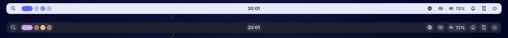

# Noctalia para Windows

Port não oficial do [Noctalia](https://noctalia.dev) (desktop shell do Linux) para o Windows 10/11.
Mesma cara, mesmas paletas, mesmos ícones e as mesmas medidas da barra do Noctalia, reescrito em
**Qt 6 + C++ + QML** em cima das APIs do Windows.




> **Estado atual: fase 1 (a barra).** Barra flutuante por monitor que reserva espaço na tela
> como a barra de tarefas, áreas de trabalho, relógio, rede, volume, bateria, menu de sessão
> e as 10 paletas do Noctalia com troca ao vivo. Os botões que no Noctalia abrem painéis
> próprios (launcher, central de controle, calendário) por enquanto abrem o equivalente do
> Windows. Veja o [roteiro](#roteiro).

---

## Como compilar

### Opção A: sem instalar nada (GitHub Actions) — recomendado para testar

1. Crie um repositório no GitHub e envie esta pasta para ele.
2. Abra a aba **Actions** do repositório. O workflow `build-windows` roda sozinho a cada push.
3. Quando terminar (uns 5 a 10 minutos na primeira vez), abra a execução e baixe o artefato
   **noctalia-win**. É uma pasta pronta: descompacte e rode `noctalia.exe`.

### Opção B: no seu PC, com Qt Creator

1. Instale o **Visual Studio 2022 Build Tools** (ou o Community) marcando
   *"Desenvolvimento para desktop com C++"*.
2. Instale o Qt pelo [Qt Online Installer](https://www.qt.io/download-qt-installer-oss)
   (conta gratuita). Marque **Qt 6.8 → MSVC 2022 64-bit** e o **Qt Creator**.
3. No Qt Creator: *Arquivo → Abrir arquivo ou projeto…* → escolha o `CMakeLists.txt`.
4. Selecione o kit *Desktop Qt 6.8 MSVC2022 64bit* e clique em ▶ (Run).

> Também compila com o kit **MinGW 64-bit** do próprio instalador do Qt, se você preferir não
> instalar o Visual Studio.

### Opção C: linha de comando

No *x64 Native Tools Command Prompt for VS 2022*:

```bat
cmake -S . -B build -G Ninja -DCMAKE_BUILD_TYPE=Release -DCMAKE_PREFIX_PATH=C:\Qt\6.8.3\msvc2022_64
cmake --build build
mkdir dist && copy build\noctalia.exe dist\
C:\Qt\6.8.3\msvc2022_64\bin\windeployqt --release --qmldir qml dist\noctalia.exe
```

---

## Como usar

Ao abrir, a barra aparece no topo de cada monitor e as janelas maximizadas passam a começar
abaixo dela. Os cliques seguem os padrões do Noctalia:

| Widget | Clique | Botão direito | Rolagem |
|---|---|---|---|
| 🔍 Launcher | Busca do Windows (até o launcher próprio ficar pronto) | Menu Iniciar | |
| Áreas de trabalho | Vai para a área de trabalho clicada | | Anterior / próxima |
| Relógio | Calendário e notificações do Windows | | |
| 🔔 Notificações | Central de notificações | | |
| Rede | Configurações rápidas | Configurações de rede | |
| Volume | Configurações rápidas | Silenciar | ±5% |
| Bateria (só notebook) | Economia de bateria | | |
| Logo do Noctalia | Configurações rápidas | **Menu do Noctalia** (editar config, recarregar, sair) | |
| ⏻ Sessão | Bloquear, sair, suspender, reiniciar, desligar | | |
| Espaço vazio da barra | | Configurações rápidas | |

Para **fechar** o Noctalia: botão direito no logo → *Sair do Noctalia*.

### Iniciar junto com o Windows

`Win + R` → digite `shell:startup` → Enter → crie ali um atalho para o `noctalia.exe`.

---

## Configuração

O arquivo fica em `%LOCALAPPDATA%\noctalia-win\config.json` e é criado na primeira execução.
Salvou, aplicou: não precisa reiniciar. Os nomes seguem o `config.toml` do Noctalia.

```json
{
  "theme": { "mode": "dark", "builtin": "Noctalia" },
  "bar": {
    "position": "top",
    "thickness": 34,
    "radius": 12,
    "margin_edge": 10,
    "margin_ends": 180,
    "capsule": false,
    "start": ["launcher", "workspaces"],
    "center": ["clock"],
    "end": ["notifications", "network", "volume", "battery", "control-center", "session"]
  }
}
```

| Chave | Valores | Padrão |
|---|---|---|
| `theme.mode` | `dark`, `light`, `auto` (segue o Windows) | `dark` |
| `theme.builtin` | `Noctalia`, `Ayu`, `Catppuccin`, `Dracula`, `Eldritch`, `Gruvbox`, `Kanagawa`, `Nord`, `Rosé Pine`, `Tokyo-Night` | `Noctalia` |
| `bar.position` | `top`, `bottom` | `top` |
| `bar.thickness` | altura da barra em px | `34` |
| `bar.radius` | arredondamento dos cantos | `12` |
| `bar.margin_edge` | distância da borda da tela | `10` |
| `bar.margin_opposite_edge` | espaço entre a barra e as janelas (sombra) | `6` |
| `bar.margin_ends` | distância das laterais da tela (`0` = barra de ponta a ponta) | `180` |
| `bar.padding` / `bar.widget_spacing` | respiro interno / espaço entre widgets | `14` / `6` |
| `bar.background_opacity` | `0.0` a `1.0` | `1.0` |
| `bar.capsule` | fundo em cápsula atrás de cada widget | `false` |
| `bar.shadow` | sombra da barra | `true` |
| `bar.reserve_space` | janelas maximizadas não cobrem a barra | `true` |
| `bar.start` / `center` / `end` | widgets: `launcher`, `workspaces`, `clock`, `notifications`, `network`, `volume`, `battery`, `control-center`, `session` | ver acima |
| `shell.font_family` | fonte da interface (vazio = Segoe UI Variable) | `""` |
| `shell.time_format` / `date_format` | formatos do [Qt](https://doc.qt.io/qt-6/qml-qtqml-qt.html#formatDateTime-method) | `HH:mm` |
| `shell.corner_radius_scale` | `0` = quadrado, `2` = bem arredondado | `1.0` |
| `shell.ui_scale` | escala da barra | `1.0` |
| `shell.animation_enabled` / `animation_speed` | animações | `true` / `1.0` |
| `windows.autohide_taskbar` | esconde a barra de tarefas do Windows enquanto o Noctalia roda | `false` |
| `windows.hide_on_fullscreen` | some durante jogos e vídeos em tela cheia | `true` |

---

## Se algo der errado

- **A barra de tarefas do Windows ficou escondida:** só acontece com `autohide_taskbar: true`
  se o Noctalia fechar à força. Abra *Configurações → Personalização → Barra de tarefas →
  Comportamentos* e desmarque *Ocultar automaticamente*.
- **Sobrou um espaço vazio no topo depois de fechar:** o Windows libera sozinho em alguns
  segundos. Se não liberar, reinicie o *Windows Explorer* no Gerenciador de Tarefas.
- **Erro no `config.json`:** um JSON inválido é ignorado e a última configuração boa continua
  valendo. Um formatador como o do VS Code mostra onde está o erro.

---

## Estrutura

```
src/
  main.cpp                inicialização e registro dos serviços no QML
  core/                   Config (JSON + recarga ao vivo), Theme (paletas), Glyphs (ícones)
  services/               áudio, bateria, rede, áreas de trabalho, ações do shell, AppBar
  platform/Platform.h     interface para o sistema (C++ puro, sem Qt)
  platform/win/           implementação Windows: Core Audio, app bar, áreas de trabalho...
  platform/stub/          dados falsos para rodar a interface no Linux
qml/
  Main.qml                uma barra por monitor
  Bar/BarWindow.qml       a barra (geometria, sombra, seções, menus)
  Bar/BarWidget.qml       base dos widgets (hover em cápsula, tooltip, cliques)
  Bar/Widgets/            cada widget da barra
  Widgets/                componentes reutilizáveis (NGlyph, NText, NTooltip, NContextMenu)
  Commons/Style.qml       medidas e tempos de animação do Noctalia
assets/                   paletas, fonte de ícones Tabler, logo
```

### Editar a interface sem recompilar

Defina `NOCTALIA_QML_DIR` apontando para a pasta `qml` do projeto e abra o `noctalia.exe`:
ele passa a ler os `.qml` do disco. Mudou um arquivo, feche e abra de novo para ver.

```bat
set NOCTALIA_QML_DIR=C:\caminho\noctalia-win\qml
noctalia.exe
```

---

## Roteiro

- [x] **Fase 1 — Barra:** barra flutuante, espaço reservado, multi-monitor, áreas de trabalho,
      relógio, rede, volume, bateria, sessão, 10 paletas, claro/escuro/auto, config ao vivo
- [ ] **Fase 2 — Painéis:** launcher próprio (apps, calculadora, emoji), central de controle
      (volume com mixer, brilho, Wi-Fi, Bluetooth, mídia), calendário
- [ ] **Fase 3 — Tema do papel de parede:** gerar a paleta a partir do papel de parede (Material You)
- [ ] **Fase 4 — Extras:** OSD de volume/brilho, bandeja do sistema, notificações próprias, dock

---

Baseado no [Noctalia](https://github.com/noctalia-dev/noctalia-shell) (MIT). Ícones
[Tabler](https://tabler.io/icons) (MIT). Veja `LICENSE` e `THIRD_PARTY_NOTICES.md`.
